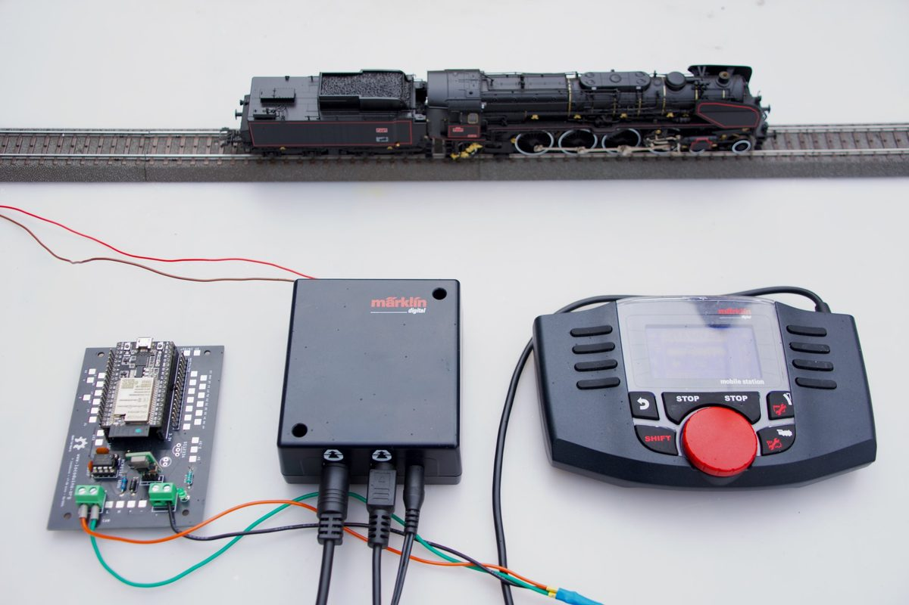
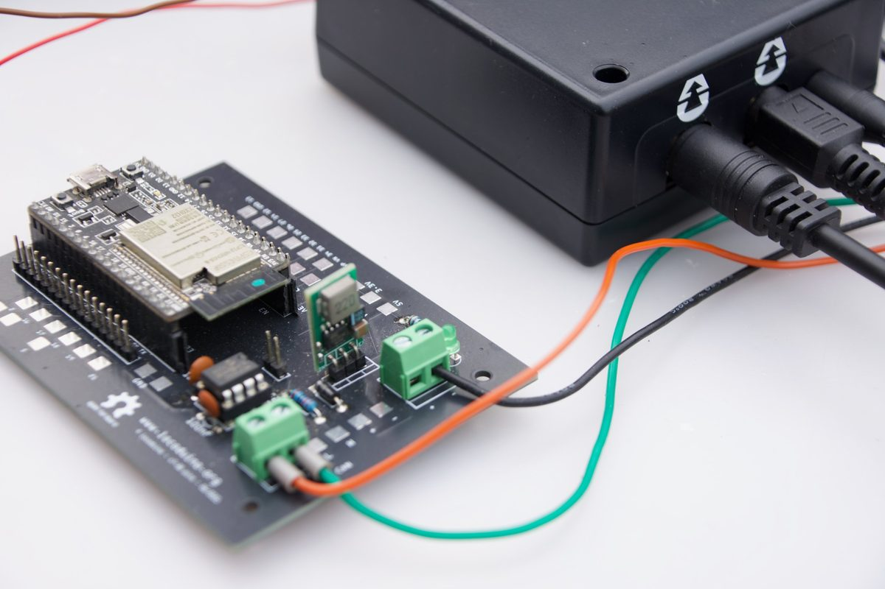

# Railuino

Bibliothèque Arduino / PlatformIO pour piloter un réseau Märklin par son bus CAN (Gleisbox, MS2, CS2) depuis un **ESP32** ou un **Arduino Uno / Mega avec un MCP2515**.
Réécriture de la bibliothèque [Railuino](https://code.google.com/archive/p/railuino/) de Joerg Pleumann.



*Railuino sur un ESP32 (à gauche), relié au bus CAN de la Gleisbox Märklin. La Mobile Station 2 reste branchée : les deux pilotent la même locomotive.*

*English below.*

Vidéo : https://youtu.be/x5fVPsChlIA

## Ce que fait la bibliothèque

- Marche / arrêt de la voie, arrêt d'urgence d'une locomotive
- Locomotives MM2, MFX et DCC : vitesse, sens de marche, fonctions
- Aiguillages et accessoires
- Lecture et écriture des CV des décodeurs
- Rétrosignalisation S88

## Cartes prises en charge



*La carte de test, dessinée pour [Locoduino](https://www.locoduino.org) : un ESP32 DevKit, un transceiver CAN MCP2562 et un régulateur d'alimentation. Le bus CAN arrive sur le bornier vert (fils orange et vert).*

| Carte | Contrôleur CAN | Pilote Railuino | Bibliothèque CAN |
| --- | --- | --- | --- |
| ESP32 | TWAI intégré + transceiver (SN65HVD230…) | `Esp32TwaiDriver` (par défaut) | [ACAN_ESP32](https://github.com/pierremolinaro/acan-esp32) ≥ 3.0.3 |
| ESP32 | MCP2515 sur le bus SPI | `Mcp2515Driver` | [ACAN2515](https://github.com/pierremolinaro/acan2515) ≥ 2.1.3 |
| Arduino Uno, Mega | MCP2515 sur le bus SPI | `Mcp2515Driver` (par défaut) | [ACAN2515](https://github.com/pierremolinaro/acan2515) ≥ 2.1.3 |

Sans pilote indiqué, `TrackController` prend le pilote par défaut de la carte. Pour en choisir un autre :

```cpp
#include <ACAN2515.h>
#include <Railuino.h>

Mcp2515Driver can(5, 4, 8000000UL);   // CS, INT, quartz
TrackController ctrl(can, 0xDF24);
```

Sur AVR, le quartz et les broches du MCP2515 par défaut se changent aussi sans modifier la bibliothèque, par exemple dans `platformio.ini` :

```ini
build_flags = -D RAILUINO_MCP2515_QUARTZ=8000000UL -D RAILUINO_MCP2515_CS=10 -D RAILUINO_MCP2515_INT=2
```

Pour un autre contrôleur CAN, dérivez la classe `CanDriver` (`src/CanDriver.h`).

## Installation

**PlatformIO** : dans le `platformio.ini` de votre projet

```ini
lib_deps = bobillechristophe/Railuino@^0.14.0
```

Les dépendances (ACAN_ESP32 ou ACAN2515) sont installées automatiquement. Pour suivre la version en cours de développement : `lib_deps = https://github.com/BOBILLEChristophe/Railuino.git`.

**IDE Arduino** : *Outils → Gérer les bibliothèques*, cherchez **Railuino** et cliquez sur *Installer*. Acceptez *Tout installer* pour ajouter aussi ACAN_ESP32 (ESP32) et ACAN2515 (Uno, Mega). Les nouvelles versions apparaissent ensuite dans le gestionnaire.

## Premier programme

```cpp
#include <Railuino.h>

#if defined(ARDUINO_ARCH_ESP32)
constexpr uint8_t CAN_RX = 22;   // TWAI de l'ESP32
constexpr uint8_t CAN_TX = 23;
#endif
constexpr uint16_t LOCO = ADDR_MFX + 7;

TrackController ctrl(0xDF24); // hash ; 0 = généré automatiquement

void setup() {
  Serial.begin(115200);
#if defined(ARDUINO_ARCH_ESP32)
  const bool canOk = ctrl.begin(CAN_RX, CAN_TX);
#else
  const bool canOk = ctrl.begin();     // MCP2515 : SPI, CS 10, INT 2
#endif
  if (!canOk) {                        // câblage, broches, quartz du MCP2515
    Serial.println("Bus CAN non démarré");
    return;
  }
  if (!ctrl.setPower(true)) {          // la Gleisbox doit être branchée
    Serial.println("Pas de réponse de la Gleisbox");
    return;
  }
  ctrl.setLocoFunction(LOCO, 0, 1);   // feux
  if (!ctrl.setLocoSpeed(LOCO, 300))  // 0 à 1000
    Serial.println("Pas de réponse pour cette adresse");
}

void loop() {}
```

Chaque commande renvoie `true` quand la centrale a répondu. La loco ne roule que si son adresse est la bonne : pour une loco MFX, c'est celle que la MS2 lui a attribuée (voir *Locomotives MFX*).

Pour recevoir les messages des autres appareils (MS2, rétrosignalisation…), enregistrez une fonction avec `ctrl.onMessage(...)` et appelez `ctrl.poll()` dans `loop()` : voir l'exemple `Monitor`. Les constantes du protocole sont dans `MarklinProtocol.h` (`Marklin::Cmd::Speed`, `Marklin::Direction::Toggle`…).

Le constructeur prend toujours le hash en premier : `TrackController(hash, debug = false, timeout_ms = 1000, loopback = false)`. Pour changer seulement le délai d'attente : `ctrl.setTimeout(500)`.

## Locomotives MFX

Une loco MFX n'a pas d'adresse fixe : la centrale lui donne un numéro (SID), et l'adresse à utiliser est `0x4000 + SID`. `MfxRegistry` tient la table UID (fixe, propre au décodeur) → adresse :

- **avec une MS2** (mode observateur, par défaut) : la MS2 inscrit les locos, Railuino écoute et apprend leurs adresses ; `mfx.locIdOf(0xFFE9B194)` donne l'adresse actuelle de la loco, même si la MS2 l'a changée ;
- **sans MS2** (mode maître) : Railuino inscrit lui-même les locos (Discovery → Bind → Verify).

```cpp
MfxRegistry mfx(ctrl);          // ou (ctrl, MfxRegistry::Mode::Master)
// setup() :
mfx.setAutoSave(true);          // table gardée après un redémarrage
mfx.begin();
// loop() :
ctrl.poll();
ctrl.setLocoSpeed(mfx.locIdOf(0xFFE9B194), 300);
```

Voir `examples/03.Mfx`.

## Exemples

Dans `examples/01.Controller` :

| Exemple | Rôle | Cartes |
| --- | --- | --- |
| Power | Marche / arrêt toutes les 5 s | toutes |
| Speed | Fait rouler une loco puis l'arrête | toutes |
| Direction | Change le sens de marche | toutes |
| Headlight | Allume et éteint les feux | toutes |
| Function | Fonctions 0 à 12 une par une | toutes |
| Turnout | Manœuvre un aiguillage | toutes |
| CV | Lit les CV d'un décodeur | toutes |
| TestAddressLoco | Cherche les adresses MFX occupées | toutes |
| SerialCommand | Commandes texte depuis le moniteur série (`help`) | toutes |
| Monitor | Affiche et décode les commandes de la MS2 (adresse d'une loco…) | toutes |
| DesktopStation | Passerelle pour le logiciel Desktop Station (d'après Uwe Monreal) | toutes |
| TcpCommand | Mêmes commandes en TCP (port 15731) | ESP32 |
| WebControl | Interface web (pages dans `data/`) ; locos MFX désignées par leur UID (`data-uid`), adresse suivie automatiquement ; aiguillages | ESP32 |

Dans `examples/02.Drivers` : `Mcp2515OnEsp32`, un ESP32 avec un module MCP2515 au lieu de son contrôleur intégré.

TcpCommand et WebControl lisent les identifiants WiFi dans un fichier `secrets.h`, à créer dans le dossier de l'exemple à partir de `secrets.h.example`. Ce fichier est ignoré par Git.

TcpCommand et WebControl n'ont pas de mot de passe : tout appareil de votre réseau local peut piloter le réseau ferré. Ne les rendez pas accessibles depuis Internet (pas de redirection de port sur la box).

## Développer la bibliothèque

Le dépôt s'ouvre directement dans VS Code avec PlatformIO. `platformio.ini` compile **un** exemple (WebControl par défaut) avec la bibliothèque de `src/` ; changez `src_dir` pour en essayer un autre.

- `pio test -e native` : tests unitaires sur PC, sans carte, avec un bus CAN simulé (`test/`).
- `sh extras/build_examples.sh` : compile tous les exemples pour toutes leurs cartes.

GitHub Actions lance ces deux vérifications à chaque envoi et à chaque pull request.

Historique des changements : [CHANGELOG.md](CHANGELOG.md).

## Licence

Bibliothèque (`src/`) : GNU LGPL 2.1 ou ultérieure, voir [LICENSE](LICENSE). Exemples : Creative Commons Zero.
Copyright (C) 2012 Joerg Pleumann, (C) 2024 – 2026 Christophe Bobille, (C) 2026 Uwe Monreal.

---

## English

Arduino / PlatformIO library to control a Märklin layout through its CAN bus (Gleisbox, MS2, CS2) from an **ESP32** or an **Arduino Uno / Mega with an MCP2515**. Rewrite of Joerg Pleumann's Railuino 0.9.

- Install with PlatformIO: `lib_deps = bobillechristophe/Railuino@^0.14.0`, or, in the Arduino IDE, *Tools → Manage Libraries*, search for **Railuino** and install it with its dependencies.
- Include `<Railuino.h>` only. Incoming messages (MS2, feedback): `onMessage()` + `poll()`, see the `Monitor` example; text commands: `CommandParser`; protocol constants: `MarklinProtocol.h`. The constructor always takes the hash first: `TrackController(hash, debug = false, timeout_ms = 1000, loopback = false)`.
- MFX: `MfxRegistry` keeps UID -> Loc-ID; observer mode with an MS2 (learns its Bind messages), master mode without (Discovery, Bind, Verify). See `examples/03.Mfx`.
- CAN drivers: `Esp32TwaiDriver` (ESP32 default) and `Mcp2515Driver` (AVR default, also on ESP32). Pass one to `TrackController(can, hash)` to choose; derive `CanDriver` for another controller. ESP32 pins go to `begin(rx, tx)`; default MCP2515 settings: `RAILUINO_MCP2515_QUARTZ`, `_CS`, `_INT`.
- Examples are in `examples/01.Controller` (see the table above). TcpCommand and WebControl need an ESP32 and a `secrets.h` file created from `secrets.h.example`.
- Development: `platformio.ini` builds one example against `src/`; `pio test -e native` runs the unit tests; `sh extras/build_examples.sh` builds every example. GitHub Actions runs both on every push.

License: LGPL 2.1 or later for the library, CC0 for the examples.
